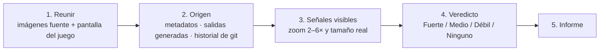

# ai-tell-check

[English](README.md) · [简体中文](README.zh-CN.md) · [繁體中文](README.zh-TW.md) · [日本語](README.ja.md) · [한국어](README.ko.md) · **Español**

Una skill para agentes que califica el **aspecto de IA** de cada recurso en el arte de juegos y apps. El aspecto de IA es cualquier señal que haga pensar a un jugador "esto lo hizo una IA generativa". La skill trabaja con archivos de imagen y capturas de pantalla, así que no depende del motor (Unity, Unreal, Godot, Cocos/Axmol, web).

## Instalación

```bash
npx skills add dlstjd0237/ai-tell-check -g
```

Se instala en Claude Code, Codex, Cursor, OpenCode y otros. Para instalarla en una sola herramienta, añade una opción como `-a claude-code`. Para instalarla a mano, copia la carpeta `skills/ai-tell-check` en `~/.claude/skills/` (Claude Code) o en `~/.agents/skills/` (Codex y otros).

El script de medición necesita Python 3.9 o posterior. Instala sus dependencias en un venv:

```bash
python -m venv .venv
.venv/bin/pip install -r skills/ai-tell-check/scripts/requirements.txt   # Windows: .venv\Scripts\pip
```

## Uso

```
/ai-tell-check Assets/Art/Background
```

O simplemente pide: "Haz ArtQA de esta carpeta. ¿Algo parece hecho con IA?"

Consejo: dile al agente dónde guardas las salidas generadas (por ejemplo, la carpeta output de ComfyUI). La comprobación de origen será mucho más rápida.

## Cómo funciona



1. **Reunir.** El agente reúne los archivos de imagen fuente, dondequiera que el motor los guarde, y la pantalla real: una captura a la resolución del juego o una composición hecha con las coordenadas del diseño.
2. **Primero, el origen.** Es la evidencia más fuerte. `aitell.py meta` busca metadatos del generador (prompts de ComfyUI/A1111, marcas de generadores 3D). `aitell.py match` compara cada recurso con las salidas generadas y con versiones anteriores del mismo archivo en git. Así detecta recursos que solo se recolorearon o se recortaron de una imagen generada, aunque se vean limpios.
3. **Señales visibles.** Cada recurso se revisa con zoom de 2–6×: perspectiva rota, composiciones en espejo, relleno sin sentido, detalles derretidos, efectos falsos, choques de estilo, halos de recorte y sustitutos como iconos emoji. Para cada señal también se anota si se ve al tamaño real del juego.
4. **Veredicto.** El origen y las señales se combinan en un solo veredicto por recurso:

   | Veredicto | Regla |
   |---|---|
   | Fuerte | Se ve una señal al tamaño real del juego (basta una si el recurso es generado; si no, dos o más) |
   | Medio | Varias señales que solo se ven con zoom, o un recurso generado cuyas señales solo se ven con zoom |
   | Débil | Un recurso generado con señales casi invisibles, o una sola señal visible solo con zoom |
   | Ninguno | No es generado y no hay señales |

   Recolorear, filtrar o recortar una imagen generada no cambia su origen.

5. **Informe.** Un resumen de una línea; una tabla con una fila por recurso (origen, veredicto, evidencia, corrección); recortes de evidencia; un orden de corrección que separa los arreglos por código de los redibujos; y los límites del método.

El script solo imprime números; el agente decide. Todas las reglas están en [SKILL.md](skills/ai-tell-check/SKILL.md).

## Usar solo la herramienta de medición

```bash
python skills/ai-tell-check/scripts/aitell.py meta  a.png model.glb        # metadatos y cadenas del generador
python skills/ai-tell-check/scripts/aitell.py match asset.png gen1.png     # ¿misma imagen que (parte de) una salida generada?
python skills/ai-tell-check/scripts/aitell.py sym   bg.png --bottom 0.35   # composición en espejo izquierda-derecha
python skills/ai-tell-check/scripts/aitell.py color a.png b.png            # croma, proporción morado-rosa, color de borde
python skills/ai-tell-check/scripts/aitell.py selftest
```

## Notas

- Los píxeles por sí solos no prueban que una imagen sea generada por IA. Los veredictos se basan en el origen y en las señales visibles.
- No se usan puntuaciones de modelos detectores de IA. La mayoría se entrenaron con fotos y no son fiables con ilustraciones.

## Licencia

MIT
