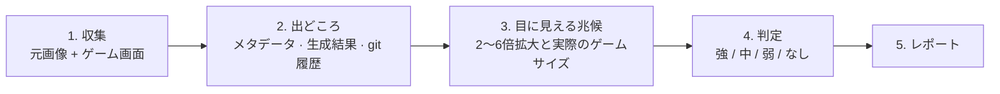

# ai-tell-check

[English](README.md) · [简体中文](README.zh-CN.md) · [繁體中文](README.zh-TW.md) · **日本語** · [한국어](README.ko.md) · [Español](README.es.md)

ゲームやアプリのアートを素材ごとに **「AIっぽさ」** で判定するエージェントスキルです。「AIっぽさ」とは、プレイヤーに「これは生成AIで作られた絵だ」と思わせるあらゆる兆候のことです。画像ファイルと画面キャプチャだけを扱うので、エンジンを問いません（Unity・Unreal・Godot・Cocos/Axmol・Web）。

## インストール

```bash
npx skills add dlstjd0237/ai-tell-check -g
```

Claude Code・Codex・Cursor・OpenCode などにインストールされます。特定のツールだけに入れる場合は `-a claude-code` のように指定します。手動でインストールする場合は、`skills/ai-tell-check` フォルダを `~/.claude/skills/`（Claude Code）または `~/.agents/skills/`（Codex など）にコピーしてください。

計測スクリプトには Python 3.9 以上が必要です。依存パッケージは venv にインストールしてください。

```bash
python -m venv .venv
.venv/bin/pip install -r skills/ai-tell-check/scripts/requirements.txt   # Windows: .venv\Scripts\pip
```

## 使い方

```
/ai-tell-check Assets/Art/Background
```

「このフォルダの ArtQA をして、AIっぽいところがないか見て」と頼むだけでも動きます。

ヒント：生成結果の置き場所（例えば ComfyUI の output フォルダ）を先に伝えておくと、出どころの確認がずっと速くなります。

## 仕組み



1. **収集。** エージェントは元の画像ファイル（エンジンがどこに置いていても）と実際の画面を集めます。実際の画面とは、ゲーム解像度でのキャプチャか、レイアウト座標どおりに合成した画像です。
2. **まず出どころ。** これが最も強い根拠です。`aitell.py meta` は生成ツールのメタデータ（ComfyUI/A1111 のプロンプト、3D 生成ツールの痕跡）を探します。`aitell.py match` は各素材を生成結果や同じファイルの git 過去バージョンと照合します。見た目がきれいでも、色だけ変えた素材や生成画像から切り抜いた素材をこれで見つけられます。
3. **目に見える兆候。** 各素材を 2〜6 倍に拡大して確認します。パースの破綻、左右対称の構図、意味のない埋め草、溶けたディテール、偽のエフェクト、画風の衝突、切り抜きの縁残り、絵文字アイコンのような代用品などです。各兆候が実際のゲームサイズでも見えるかどうかも記録します。
4. **判定。** 出どころと兆候を合わせて、素材ごとに判定を一つだけ出します。

   | 判定 | 基準 |
   |---|---|
   | 強 | 実際のゲームサイズで兆候が見える（生成素材なら一つで十分、それ以外は二つ以上） |
   | 中 | 拡大しないと見えない兆候が複数ある、または生成素材で兆候が拡大しないと見えない |
   | 弱 | 生成素材だが兆候がほとんど見えない、または拡大しないと見えない兆候が一つだけ |
   | なし | 生成素材ではなく、兆候もない |

   生成画像の色を変えても、フィルターをかけても、切り抜いても、出どころは変わりません。

5. **レポート。** 一行の要約、素材ごとに一行の表（出どころ・判定・根拠・修正方法）、根拠の拡大画像、「コードで直せる」と「描き直しが必要」を分けた修正の順番、方法の限界を出します。

スクリプトは数値を出すだけで、判断はエージェントがします。基準はすべて [SKILL.md](skills/ai-tell-check/SKILL.md) に書かれています。

## 計測ツールだけを使う

```bash
python skills/ai-tell-check/scripts/aitell.py meta  a.png model.glb        # 生成ツールのメタデータ・文字列
python skills/ai-tell-check/scripts/aitell.py match asset.png gen1.png     # 生成結果（の一部）と同じ絵か
python skills/ai-tell-check/scripts/aitell.py sym   bg.png --bottom 0.35   # 左右の鏡像構図
python skills/ai-tell-check/scripts/aitell.py color a.png b.png            # 彩度・紫〜ピンクの割合・縁の色
python skills/ai-tell-check/scripts/aitell.py selftest
```

## 注意

- 画素だけで AI 生成かどうかを証明することはできません。判定は出どころと目に見える兆候に基づきます。
- AI 判定モデルのスコアは使いません。多くは写真で学習しており、イラストでは当てになりません。

## ライセンス

MIT
