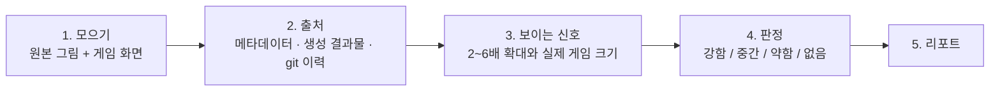

# ai-tell-check

[English](README.md) · [简体中文](README.zh-CN.md) · [繁體中文](README.zh-TW.md) · [日本語](README.ja.md) · **한국어** · [Español](README.es.md)

게임·앱 아트에서 **AI 티**를 자산마다 판정하는 에이전트 스킬입니다. AI 티는 유저가 "생성형 AI 그림이네"라고 의심하게 만드는 신호를 말합니다. 그림 파일과 화면 캡처만 다루기 때문에 엔진에 상관없이 쓸 수 있습니다(Unity·Unreal·Godot·Cocos/Axmol·웹).

## 설치

```bash
npx skills add dlstjd0237/ai-tell-check -g
```

Claude Code, Codex, Cursor, OpenCode 등에 설치됩니다. 한 도구에만 넣으려면 `-a claude-code`처럼 지정하세요. 손으로 설치할 때는 `skills/ai-tell-check` 폴더를 `~/.claude/skills/`(Claude Code)나 `~/.agents/skills/`(Codex 등)에 복사하면 됩니다.

측정 스크립트는 Python 3.9 이상이 필요합니다. 의존성은 venv에 설치하세요.

```bash
python -m venv .venv
.venv/bin/pip install -r skills/ai-tell-check/scripts/requirements.txt   # Windows: .venv\Scripts\pip
```

## 사용

```
/ai-tell-check Assets/Art/Background
```

또는 "이 폴더 ArtQA 해 줘, AI 티 나는지 봐 줘"라고 말해도 됩니다.

팁: 생성 결과물을 두는 곳(예: ComfyUI output 폴더)을 미리 알려 주면 출처 확인이 훨씬 빨라집니다.

## 동작 방식



1. **모으기.** 에이전트가 원본 그림 파일(엔진이 어디에 두든)과 실제 화면을 모읍니다. 실제 화면은 게임 해상도 그대로 찍은 캡처나, 배치 좌표대로 합성한 그림입니다.
2. **출처부터.** 가장 강한 증거입니다. `aitell.py meta`는 생성 도구 메타데이터(ComfyUI·A1111 프롬프트, 3D 생성기 흔적)를 찾습니다. `aitell.py match`는 자산마다 생성 결과물, 같은 파일의 git 이전 버전과 대조합니다. 그래서 겉보기에 깨끗해도 색만 바꿨거나 생성 그림에서 오려 낸 자산을 찾아냅니다.
3. **보이는 신호.** 자산마다 2~6배로 확대해서 봅니다. 원근 불일치, 거울 구도, 의미 없는 채우기, 녹은 디테일, 가짜 연출, 화풍 충돌, 누끼 흔적, 이모지 아이콘 같은 기성품 대용 등입니다. 신호마다 실제 게임 크기에서도 보이는지 따로 적습니다.
4. **판정.** 출처와 신호를 합쳐 자산마다 판정을 하나만 냅니다.

   | 판정 | 기준 |
   |---|---|
   | 강함 | 게임 크기에서 신호가 보임(생성 자산이면 1개로 충분, 아니면 2개 이상) |
   | 중간 | 확대해야 보이는 신호가 여럿, 또는 생성 자산인데 신호가 확대해야 보임 |
   | 약함 | 생성 자산인데 신호가 거의 안 보임, 또는 확대 신호가 1개뿐 |
   | 없음 | 생성 자산이 아니고 신호도 없음 |

   생성 그림의 색을 바꾸거나 필터를 씌우거나 잘라 내도 출처는 바뀌지 않습니다.

5. **리포트.** 한 줄 요약, 자산마다 한 줄씩인 표(출처·판정·근거·처방), 근거 크롭, "코드로 됨"과 "다시 그려야 함"을 나눈 고칠 순서, 방법과 한계를 냅니다.

스크립트는 숫자만 내고 판단은 에이전트가 합니다. 기준은 전부 [SKILL.md](skills/ai-tell-check/SKILL.md)에 있습니다.

## 측정 도구만 쓰기

```bash
python skills/ai-tell-check/scripts/aitell.py meta  a.png model.glb        # 생성 도구 메타데이터·문자열
python skills/ai-tell-check/scripts/aitell.py match asset.png gen1.png     # 생성 결과물(의 일부)과 같은 그림인지
python skills/ai-tell-check/scripts/aitell.py sym   bg.png --bottom 0.35   # 좌우 거울 구도
python skills/ai-tell-check/scripts/aitell.py color a.png b.png            # 채도·보라핑크 비율·가장자리 색
python skills/ai-tell-check/scripts/aitell.py selftest
```

## 주의

- 그림만 보고 AI 여부를 확정할 수는 없습니다. 이 스킬의 판정은 출처와 보이는 신호를 근거로 한 것입니다.
- 판별 모델 점수는 쓰지 않습니다. 대부분 사진으로 학습해서 일러스트에서는 잘 틀립니다.

## 라이선스

MIT
