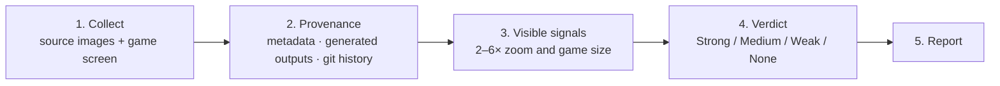

# ai-tell-check

**English** · [简体中文](README.zh-CN.md) · [繁體中文](README.zh-TW.md) · [日本語](README.ja.md) · [한국어](README.ko.md) · [Español](README.es.md)

An agent skill that rates the **AI tell** of every asset in game and app art. An AI tell is anything that makes a player think "this was made by generative AI". The skill works on image files and screen captures, so it does not depend on the engine (Unity, Unreal, Godot, Cocos/Axmol, web).

## Install

```bash
npx skills add dlstjd0237/ai-tell-check -g
```

This installs the skill for Claude Code, Codex, Cursor, OpenCode, and others. To install for a single tool, add a flag such as `-a claude-code`. To install by hand, copy the `skills/ai-tell-check` folder into `~/.claude/skills/` (Claude Code) or `~/.agents/skills/` (Codex and others).

The measuring script needs Python 3.9 or later. Install its dependencies into a venv:

```bash
python -m venv .venv
.venv/bin/pip install -r skills/ai-tell-check/scripts/requirements.txt   # Windows: .venv\Scripts\pip
```

## Usage

```
/ai-tell-check Assets/Art/Background
```

Or just ask: "Run ArtQA on this folder. Does anything look AI-generated?"

Tip: tell the agent where your generated outputs are kept (for example, your ComfyUI output folder). The provenance check gets much faster.

## How it works



1. **Collect.** The agent gathers the source image files, wherever the engine keeps them, and the real screen: a capture at game resolution, or a composite built from the layout coordinates.
2. **Provenance first.** This is the strongest evidence. `aitell.py meta` looks for generator metadata (ComfyUI/A1111 prompts, 3D-generator markers). `aitell.py match` compares each asset with generated outputs and with earlier git versions of the same file. This catches assets that were only recolored or cut out of a generated image, even when they look clean.
3. **Visible signals.** Each asset is checked at 2–6× zoom for broken perspective, mirrored layouts, meaningless filler, melted detail, fake effects, style clashes, cut-out halos, and stand-ins such as emoji icons. Each signal is also marked as visible or not at game size.
4. **Verdict.** Provenance and signals combine into exactly one verdict per asset:

   | Verdict | Rule |
   |---|---|
   | Strong | A signal is visible at game size (one is enough for a generated asset, otherwise two or more) |
   | Medium | Several signals visible only when zoomed, or a generated asset whose signals show only when zoomed |
   | Weak | A generated asset whose signals are barely visible, or a single zoom-only signal |
   | None | Not generated, and no signals |

   Recoloring, filtering, or cropping a generated image does not change its provenance.

5. **Report.** A one-line summary; a table with one row per asset (provenance, verdict, evidence, fix); evidence crops; a fix order that separates code fixes from redraws; and the limits of the method.

The script only prints numbers; the agent makes the call. All the rules are in [SKILL.md](skills/ai-tell-check/SKILL.md).

## Using the measuring tool alone

```bash
python skills/ai-tell-check/scripts/aitell.py meta  a.png model.glb        # generator metadata and strings
python skills/ai-tell-check/scripts/aitell.py match asset.png gen1.png     # same image as (part of) a generated output?
python skills/ai-tell-check/scripts/aitell.py sym   bg.png --bottom 0.35   # left-right mirror layout
python skills/ai-tell-check/scripts/aitell.py color a.png b.png            # chroma, purple-pink share, edge color
python skills/ai-tell-check/scripts/aitell.py selftest
```

## Notes

- Pixels alone cannot prove that an image is AI-generated. Verdicts rest on provenance and visible signals.
- AI-detector model scores are not used. Most are trained on photos and are unreliable on illustration.

## License

MIT
