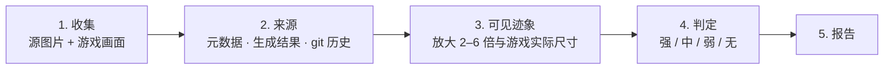

# ai-tell-check

[English](README.md) · **简体中文** · [繁體中文](README.zh-TW.md) · [日本語](README.ja.md) · [한국어](README.ko.md) · [Español](README.es.md)

一个为游戏和应用美术逐个资源判定 **"AI 感"** 的智能体技能。"AI 感"指任何会让玩家觉得"这是生成式 AI 画的"的迹象。它只处理图片文件和屏幕截图，因此与引擎无关（Unity、Unreal、Godot、Cocos/Axmol、Web）。

## 安装

```bash
npx skills add dlstjd0237/ai-tell-check -g
```

可安装到 Claude Code、Codex、Cursor、OpenCode 等。只想装到某一个工具时，加上 `-a claude-code` 之类的参数。手动安装时，把 `skills/ai-tell-check` 文件夹复制到 `~/.claude/skills/`（Claude Code）或 `~/.agents/skills/`（Codex 等）。

测量脚本需要 Python 3.9 及以上。请把依赖安装到 venv 中：

```bash
python -m venv .venv
.venv/bin/pip install -r skills/ai-tell-check/scripts/requirements.txt   # Windows: .venv\Scripts\pip
```

## 用法

```
/ai-tell-check Assets/Art/Background
```

也可以直接说："对这个文件夹做 ArtQA，看看有没有 AI 感。"

提示：事先告诉智能体生成结果放在哪里（例如 ComfyUI 的 output 文件夹），来源核查会快很多。

## 工作原理



1. **收集。** 智能体收集源图片文件（不论引擎把它们放在哪里）和真实画面：按游戏分辨率截取的画面，或按布局坐标合成的画面。
2. **先查来源。** 这是最有力的证据。`aitell.py meta` 查找生成工具的元数据（ComfyUI/A1111 提示词、3D 生成器标记）。`aitell.py match` 把每个资源与生成结果以及同一文件的 git 历史版本比对。这样即使资源看起来很干净，也能找出只改了颜色、或从生成图中抠出来的资源。
3. **可见迹象。** 在 2–6 倍放大下检查每个资源：透视错误、镜像构图、无意义的填充细节、融化的细节、假特效、画风冲突、抠图残边，以及 emoji 图标之类的替代品。每个迹象还会标明在游戏实际尺寸下是否可见。
4. **判定。** 来源与迹象合起来，每个资源只给一个判定：

   | 判定 | 规则 |
   |---|---|
   | 强 | 在游戏实际尺寸下能看到迹象（生成的资源有一个就够，否则需要两个以上） |
   | 中 | 有多个只有放大才能看到的迹象，或资源是生成的且迹象只有放大才能看到 |
   | 弱 | 资源是生成的但迹象几乎看不到，或只有一个放大才能看到的迹象 |
   | 无 | 不是生成的，也没有迹象 |

   对生成图改色、加滤镜或裁切，都不会改变它的来源。

5. **报告。** 一句话总结；每个资源一行的表格（来源、判定、证据、修改方法）；证据截图；区分"代码可修"与"需要重画"的修改顺序；以及方法的局限。

脚本只输出数字，由智能体做判断。全部规则写在 [SKILL.md](skills/ai-tell-check/SKILL.md) 里。

## 单独使用测量工具

```bash
python skills/ai-tell-check/scripts/aitell.py meta  a.png model.glb        # 生成工具元数据与字符串
python skills/ai-tell-check/scripts/aitell.py match asset.png gen1.png     # 是否与生成结果（的一部分）为同一张图
python skills/ai-tell-check/scripts/aitell.py sym   bg.png --bottom 0.35   # 左右镜像构图
python skills/ai-tell-check/scripts/aitell.py color a.png b.png            # 彩度、紫粉占比、边缘颜色
python skills/ai-tell-check/scripts/aitell.py selftest
```

## 注意

- 仅凭像素无法证明一张图是 AI 生成的。判定依据是来源和可见迹象。
- 不使用 AI 检测模型的分数。它们大多用照片训练，对插画不可靠。

## 许可证

MIT
