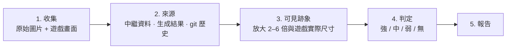

# ai-tell-check

[English](README.md) · [简体中文](README.zh-CN.md) · **繁體中文** · [日本語](README.ja.md) · [한국어](README.ko.md) · [Español](README.es.md)

一個為遊戲與應用程式美術逐一資源判定 **「AI 感」** 的代理技能。「AI 感」指任何會讓玩家覺得「這是生成式 AI 畫的」的跡象。它只處理圖片檔與螢幕截圖，因此與引擎無關（Unity、Unreal、Godot、Cocos/Axmol、Web）。

## 安裝

```bash
npx skills add dlstjd0237/ai-tell-check -g
```

可安裝到 Claude Code、Codex、Cursor、OpenCode 等。只想裝到某一個工具時，加上 `-a claude-code` 之類的參數。手動安裝時，把 `skills/ai-tell-check` 資料夾複製到 `~/.claude/skills/`（Claude Code）或 `~/.agents/skills/`（Codex 等）。

測量腳本需要 Python 3.9 以上。請把相依套件安裝到 venv 中：

```bash
python -m venv .venv
.venv/bin/pip install -r skills/ai-tell-check/scripts/requirements.txt   # Windows: .venv\Scripts\pip
```

## 用法

```
/ai-tell-check Assets/Art/Background
```

也可以直接說：「對這個資料夾做 ArtQA，看看有沒有 AI 感。」

提示：事先告訴代理生成結果放在哪裡（例如 ComfyUI 的 output 資料夾），來源查核會快很多。

## 運作方式



1. **收集。** 代理收集原始圖片檔（不論引擎把它們放在哪裡）與實際畫面：以遊戲解析度擷取的畫面，或依版面座標合成的畫面。
2. **先查來源。** 這是最有力的證據。`aitell.py meta` 尋找生成工具的中繼資料（ComfyUI/A1111 提示詞、3D 生成器標記）。`aitell.py match` 把每個資源與生成結果以及同一檔案的 git 歷史版本比對。如此一來，即使資源看起來很乾淨，也能找出只改了顏色、或從生成圖中去背切出的資源。
3. **可見跡象。** 在 2–6 倍放大下檢查每個資源：透視錯誤、鏡像構圖、無意義的填充細節、融化的細節、假特效、畫風衝突、去背殘邊，以及 emoji 圖示之類的替代品。每個跡象也會標明在遊戲實際尺寸下是否看得到。
4. **判定。** 來源與跡象合起來，每個資源只給一個判定：

   | 判定 | 規則 |
   |---|---|
   | 強 | 在遊戲實際尺寸下看得到跡象（生成的資源有一個就夠，否則需要兩個以上） |
   | 中 | 有多個只有放大才看得到的跡象，或資源是生成的且跡象只有放大才看得到 |
   | 弱 | 資源是生成的但跡象幾乎看不到，或只有一個放大才看得到的跡象 |
   | 無 | 不是生成的，也沒有跡象 |

   對生成圖改色、套濾鏡或裁切，都不會改變它的來源。

5. **報告。** 一句話總結；每個資源一列的表格（來源、判定、證據、修改方式）；證據截圖；區分「程式可修」與「需要重畫」的修改順序；以及方法的限制。

腳本只輸出數字，由代理做判斷。所有規則都寫在 [SKILL.md](skills/ai-tell-check/SKILL.md) 裡。

## 單獨使用測量工具

```bash
python skills/ai-tell-check/scripts/aitell.py meta  a.png model.glb        # 生成工具中繼資料與字串
python skills/ai-tell-check/scripts/aitell.py match asset.png gen1.png     # 是否與生成結果（的一部分）為同一張圖
python skills/ai-tell-check/scripts/aitell.py sym   bg.png --bottom 0.35   # 左右鏡像構圖
python skills/ai-tell-check/scripts/aitell.py color a.png b.png            # 彩度、紫粉比例、邊緣顏色
python skills/ai-tell-check/scripts/aitell.py selftest
```

## 注意

- 僅憑像素無法證明一張圖是 AI 生成的。判定依據是來源與可見跡象。
- 不使用 AI 偵測模型的分數。它們大多以照片訓練，對插畫不可靠。

## 授權

MIT
